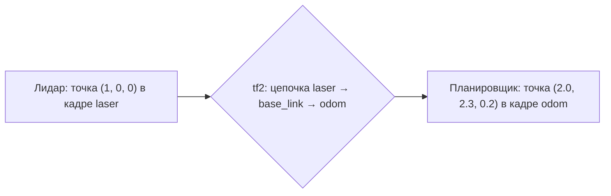
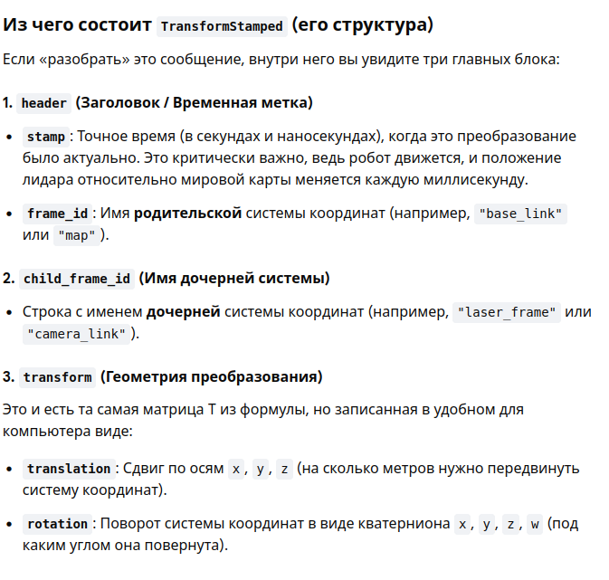
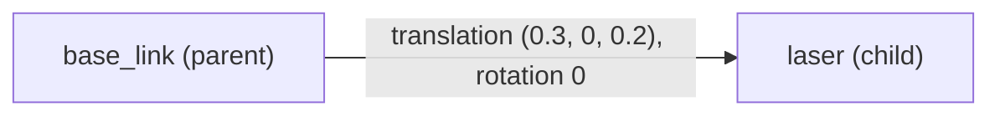
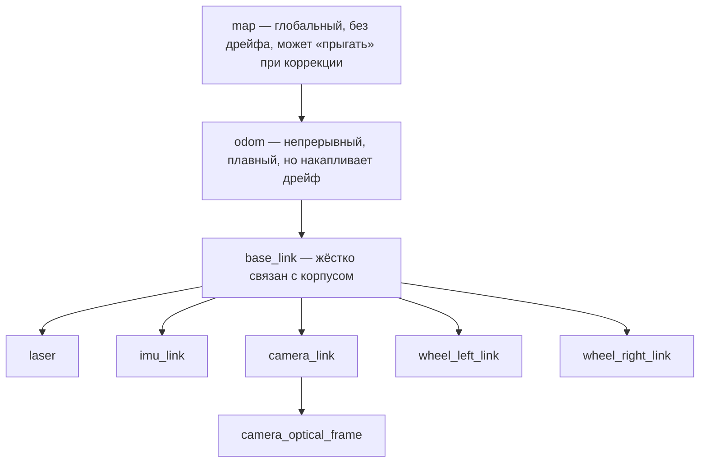
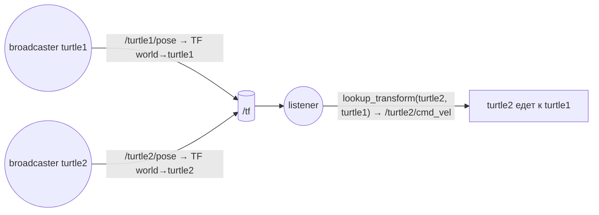
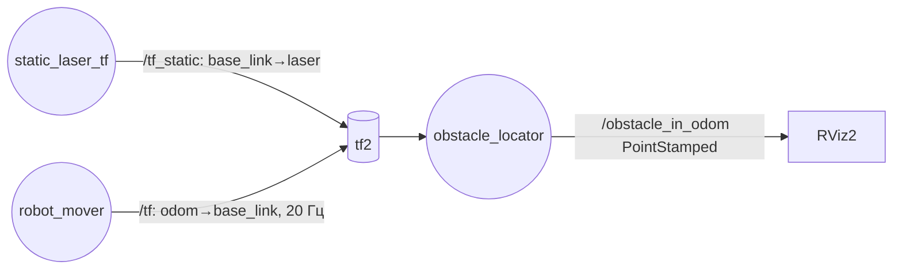
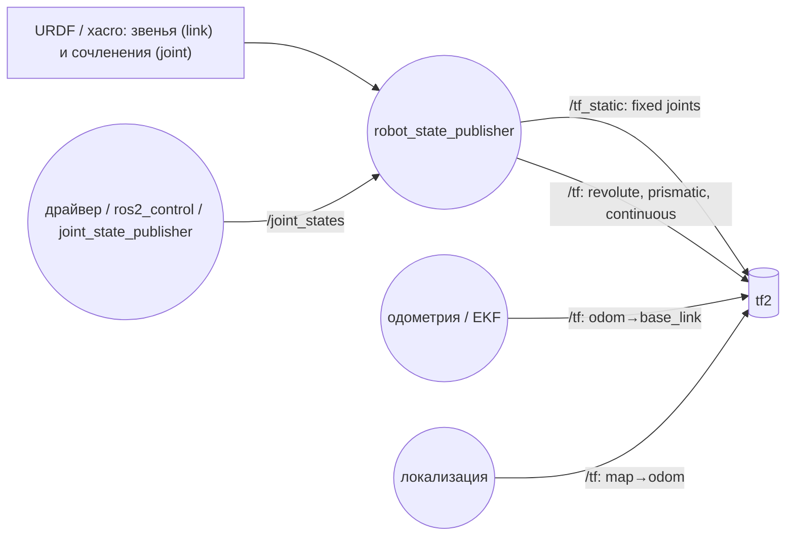
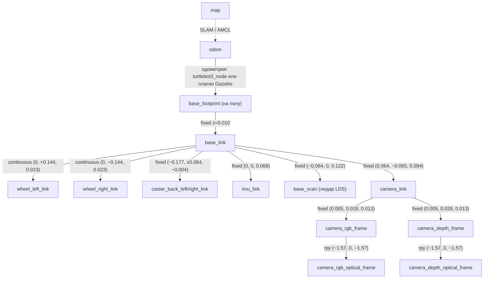
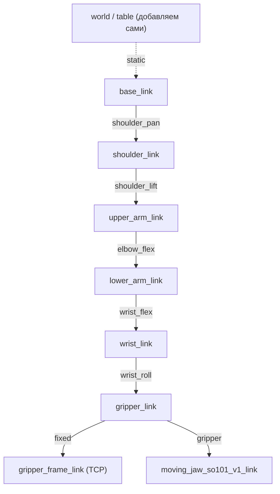

# Переход к tf2 и frame_id в ROS 2 — Jazzy на WSL2

Продолжение курса «Структура ROS 2». Нужны модули 1–12 (узлы, топики, пакеты, launch). Здесь подробно разобран модуль 15, где tf2 был показан только обзорно.

Окружение: Windows 11 + WSL2 + Ubuntu 24.04 + ROS 2 Jazzy + Python 3.12.

---

## Карта модуля

| № | Раздел | Ключевая идея | Время |
|---|--------|---------------|-------|
| 1 | Зачем нужен tf2 | Каждый датчик «видит мир» в своей системе координат | 20 мин |
| 2 | frame_id и Header | Любое пространственное сообщение подписано именем кадра | 30 мин |
| 3 | Преобразование | Смещение + поворот, направление «родитель → потомок» | 40 мин |
| 4 | Дерево кадров | Один корень, у каждого кадра один родитель, REP 103 и REP 105 | 30 мин |
| 5 | Кватернионы на практике | Как задать поворот и не ошибиться | 30 мин |
| 6 | tf2 из командной строки | static_transform_publisher, tf2_echo, view_frames, RViz2 | 45 мин |
| 7 | Ручной расчёт | Проверяем tf2 на бумаге | 30 мин |
| 8 | tf2 в коде Python | broadcaster, static broadcaster, listener | 90 мин |
| 9 | Время в tf2 | Буфер, метки времени, ошибки экстраполяции | 30 мин |
| 10 | Откуда берутся кадры в реальном роботе | URDF + robot_state_publisher, одометрия | 30 мин |
| 11 | Частые ошибки | Диагностика | 20 мин |
| 12 | Задания | От turtlesim к реальным роботам | 1 ч |
| 13 | Кейс A: TurtleBot3 Waffle | Мобильный робот: `map → odom → base_footprint → датчики` | 3–4 ч |
| 14 | Кейс B: SO-101 | Манипулятор: прямая кинематика через tf2 | 3–4 ч |

---

## 1. Зачем нужен tf2

Представьте мобильного робота с лидаром на корпусе. Лидар сообщает: «препятствие в 1 м прямо перед мной». Планировщику пути нужно другое: «где препятствие на карте?». Чтобы ответить, надо знать:

1. где лидар закреплён на корпусе (это постоянная величина);
2. где корпус находится в мире сейчас (величина меняется при движении).

Если в роботе 10 датчиков и 3 подвижных звена, такие пересчёты придётся делать в каждом узле. Ошибки неизбежны.

**tf2** — библиотека, которая берёт эту задачу на себя:

- узлы **публикуют** известные им связи между системами координат;
- tf2 собирает их в **дерево** и хранит историю за последние секунды (по умолчанию 10 с);
- любой узел может **спросить**: «как перевести данные из кадра A в кадр B на момент t?», и tf2 сам пройдёт по цепочке.



**Кадр (frame)** — это система координат с именем: начало отсчёта плюс три оси. Обычно кадр «прикреплён» к физическому объекту: корпусу, датчику, звену, комнате.

---

## 2. frame_id и Header

### 2.1. Header

Почти все сообщения с пространственными данными начинаются с заголовка `std_msgs/msg/Header`:

```bash
ros2 interface show std_msgs/msg/Header
```
```
builtin_interfaces/Time stamp   # КОГДА измерены данные
string frame_id                 # В КАКОЙ системе координат они выражены
```

Именно эти два поля связывают данные с tf2. Без них нельзя ответить на вопрос «где это было».


### 2.2. Где встречается frame_id

```bash
ros2 interface show sensor_msgs/msg/LaserScan | head -5
ros2 interface show geometry_msgs/msg/PointStamped
ros2 interface show nav_msgs/msg/Odometry | grep -E "frame|Header"
ros2 interface show geometry_msgs/msg/TransformStamped
```

| Сообщение | Смысл `header.frame_id` |
|-----------|-------------------------|
| `sensor_msgs/LaserScan`, `PointCloud2` | кадр датчика, например `laser` |
| `sensor_msgs/Imu` | кадр, в котором выражена ориентация и ускорения (`imu_link`) |
| `sensor_msgs/Image`, `CameraInfo` | оптический кадр камеры (`camera_optical_frame`) |
| `geometry_msgs/PointStamped`, `PoseStamped` | кадр, в котором заданы координаты |
| `nav_msgs/Odometry` | `frame_id` = `odom` (мир), `child_frame_id` = `base_link` (робот) |
| `geometry_msgs/TransformStamped` | `frame_id` = родитель, `child_frame_id` = потомок |

Сообщения без суффикса `Stamped` (`Point`, `Pose`, `Twist`) **не содержат** frame_id. Это «голые» числа: их система координат известна только по договорённости. Поэтому в tf2 работают со `Stamped`-версиями.

---
*   **`map` (Глобальная карта)** — Абсолютная, неподвижная система координат здания. Привязана к реальным стенам. **Не накапливает ошибку** (за точность отвечает лидар или камера через алгоритмы SLAM/AMCL).
*   **`odom` (Одометрия)** — Виртуальная точка старта робота на земле. Накапливает **ошибку из-за проскальзывания колес** (дрейф). Нужна для плавного отслеживания движения на коротких дистанциях.
*   **`base_link` (Робот)** — Физический центр самого робота (его жесткая база). Постоянно движется вместе с ним. К этой точке привязываются все датчики (лидары, камеры).

---

### Иерархия (TF-дерево)
\[\mathbf{map} \longrightarrow \mathbf{odom} \longrightarrow \mathbf{base\_link}\]

**Главный принцип работы:** Алгоритм навигации постоянно сдвигает фрейм `odom` относительно фрейма `map`. Это позволяет на лету исправлять ошибку буксующих колес и удерживать робота в правильной точке на карте.

### 2.3. Правила именования

- Без ведущего слэша: `base_link`, а не `/base_link`. В ROS 2 tf2 отвергает имена со слэшем в начале.
- Только латиница, цифры, `_`. Стандартные имена: `map`, `odom`, `base_link`, `base_footprint`, `laser`, `imu_link`, `camera_link`.
- Для нескольких роботов используйте префикс: `robot1/base_link`, `robot2/base_link`.

### 2.4. Мини-эксперимент

```bash
ros2 topic pub --rate 1 /target geometry_msgs/msg/PointStamped \
  "{header: {frame_id: 'base_link'}, point: {x: 1.0, y: 0.5, z: 0.0}}"
```
Подписчик получит не просто «(1, 0.5, 0)», а «(1, 0.5, 0) относительно base_link». Одни и те же числа в кадрах `map` и `base_link` означают разные точки пространства.

---

## 3. Преобразование (transform)

### 3.1. Из чего состоит

```bash
ros2 interface show geometry_msgs/msg/Transform
```
```
Vector3 translation     # смещение начала координат потомка, x y z в метрах
Quaternion rotation     # поворот осей потомка, x y z w
```

`TransformStamped` добавляет время и имена двух кадров:

```
header.stamp       — момент времени
header.frame_id    — родительский кадр (parent)
child_frame_id     — дочерний кадр (child)
transform          — translation + rotation
```

### 3.2. Самое важное: направление

Преобразование `parent → child` можно читать двумя равносильными способами:

1. **Поза потомка в родителе:** «начало кадра `laser` находится в точке (0.3, 0, 0.2) кадра `base_link`, оси повёрнуты на такой-то угол».
2. **Пересчёт координат из потомка в родителя:** точку, известную в `laser`, можно перевести в `base_link`.



Запомните формулу (\(T\) — однородная матрица 4×4):

\[
p_{\text{parent}} = T_{\text{parent}\leftarrow\text{child}} \cdot p_{\text{child}}
\]

Для цепочки преобразования перемножаются слева направо от корня:

\[
p_{\text{odom}} = T_{\text{odom}\leftarrow\text{base\_link}} \cdot T_{\text{base\_link}\leftarrow\text{laser}} \cdot p_{\text{laser}}
\]

В tf2 есть только **один** вызов для запроса:

```python
buffer.lookup_transform(target_frame, source_frame, time)
```

Он возвращает преобразование, которое переводит данные **из** `source_frame` **в** `target_frame` (то есть позу `source` в `target`). Если перепутать аргументы, получится обратное преобразование: самая частая ошибка новичков.

### 3.3. Однородная матрица

\[
T = \begin{bmatrix} R_{3\times3} & t_{3\times1} \\ 0\;0\;0 & 1 \end{bmatrix},\qquad
\begin{bmatrix} p' \\ 1 \end{bmatrix} = T \begin{bmatrix} p \\ 1 \end{bmatrix} = \begin{bmatrix} R\,p + t \\ 1 \end{bmatrix}
\]

Сначала поворот, потом сдвиг. Обратное преобразование: \(T^{-1}\) с \(R^{T}\) и \(-R^{T}t\). tf2 вычисляет его сам, когда вы идёте по дереву «вверх».

---

## 4. Дерево кадров

### 4.1. Правила дерева

- У каждого кадра **ровно один родитель** (кроме корня).
- **Нет циклов.**
- Все кадры связаны в **одно** дерево. Если дерево распалось на два, между ними нельзя пересчитать координаты.
- У родителя может быть сколько угодно потомков.

Почему не граф? Если бы у `base_link` было два родителя (`odom` и `map`) с несогласованными данными, ответ на запрос «где робот» стал бы неоднозначным. Дерево гарантирует единственный путь между двумя любыми кадрами.

### 4.2. Стандартная структура мобильного робота (REP 105)



| Связь | Кто публикует | Тип |
|-------|---------------|-----|
| `map → odom` | локализация (AMCL, SLAM) | динамическая, «поправка дрейфа» |
| `odom → base_link` | одометрия (колёса, IMU, фильтр EKF) | динамическая, плавная |
| `base_link → laser`, `imu_link`, `camera_link` | `robot_state_publisher` из URDF | статическая |
| `base_link → wheel_*` | `robot_state_publisher` + `joint_states` | динамическая (вращение колёс) |

Интересный момент: локализация публикует не `map → base_link`, а `map → odom`. Иначе у `base_link` было бы два родителя.

### 4.3. Соглашения об осях (REP 103)

- Правая тройка осей.
- Для корпуса робота: **x — вперёд, y — влево, z — вверх**.
- Положительный поворот — против часовой стрелки, если смотреть с конца оси (правило правой руки).
- Единицы: метры, радианы, секунды.
- **Исключение — оптические кадры камер** (`*_optical_frame`): z — вперёд, x — вправо, y — вниз. Поэтому у камеры два кадра: `camera_link` (как у корпуса) и `camera_optical_frame` (как у изображения).

### 4.4. /tf и /tf_static

```bash
ros2 topic info -v /tf_static
```

| Топик | Что в нём | QoS |
|-------|-----------|-----|
| `/tf` | динамические преобразования, публикуются постоянно (10–100 Гц) | обычный |
| `/tf_static` | неизменные преобразования, публикуются **один раз** | `TRANSIENT_LOCAL` — новые подписчики сразу получат сохранённые сообщения |

Тип сообщения у обоих — `tf2_msgs/msg/TFMessage` (массив `TransformStamped`).

---

## 5. Кватернионы на практике

### 5.1. Минимум теории

Поворот в tf2 хранится кватернионом \(q = (x, y, z, w)\), \(x^2+y^2+z^2+w^2 = 1\). Поворот на угол \(\theta\) вокруг единичной оси \(n\):

\[
q = \left(n_x \sin\tfrac{\theta}{2},\; n_y \sin\tfrac{\theta}{2},\; n_z \sin\tfrac{\theta}{2},\; \cos\tfrac{\theta}{2}\right)
\]

Для робота на плоскости почти всегда нужен только поворот вокруг z (рыскание, yaw):

\[
q_{\text{yaw}} = \left(0,\; 0,\; \sin\tfrac{\theta}{2},\; \cos\tfrac{\theta}{2}\right)
\]

| Поворот | x | y | z | w |
|---------|---|---|---|---|
| нет поворота | 0 | 0 | 0 | **1** |
| yaw = 90° | 0 | 0 | 0.7071 | 0.7071 |
| yaw = 180° | 0 | 0 | 1 | 0 |
| roll = 90° | 0.7071 | 0 | 0 | 0.7071 |

Типичная ошибка: оставить кватернион нулевым `(0, 0, 0, 0)`. Это не «нет поворота», а недопустимое значение. «Нет поворота» — это `w = 1`.

### 5.2. Функция для Python (без внешних зависимостей)

```python
import math

def quaternion_from_euler(roll, pitch, yaw):
    """Углы Эйлера (рад), порядок XYZ «неподвижных осей», как в tf2 → (x, y, z, w)."""
    cr, sr = math.cos(roll / 2), math.sin(roll / 2)
    cp, sp = math.cos(pitch / 2), math.sin(pitch / 2)
    cy, sy = math.cos(yaw / 2), math.sin(yaw / 2)
    return (
        sr * cp * cy - cr * sp * sy,
        cr * sp * cy + sr * cp * sy,
        cr * cp * sy - sr * sp * cy,
        cr * cp * cy + sr * sp * sy,
    )


def yaw_from_quaternion(x, y, z, w):
    return math.atan2(2 * (w * z + x * y), 1 - 2 * (y * y + z * z))
```

Альтернатива: пакет `ros-jazzy-tf-transformations` (`from tf_transformations import quaternion_from_euler`), ему нужен `pip`-пакет `transforms3d`. Для учебных задач функции выше достаточно.

---

## 6. tf2 из командной строки

### 6.1. Подготовка

```bash
sudo apt update
sudo apt install -y ros-jazzy-tf2-ros ros-jazzy-tf2-tools ros-jazzy-tf2-geometry-msgs \
                    ros-jazzy-turtle-tf2-py ros-jazzy-rviz2
```

### 6.2. Строим дерево руками

Три терминала. Сначала связь «мир → робот» (пока делаем её статической, будто робот стоит):

```bash
# Терминал 1: робот стоит в точке (2, 1), повернут на 90°
ros2 run tf2_ros static_transform_publisher \
  --x 2 --y 1 --z 0 --yaw 1.5708 --frame-id odom --child-frame-id base_link

# Терминал 2: лидар на 0.3 м впереди и 0.2 м выше центра корпуса
ros2 run tf2_ros static_transform_publisher \
  --x 0.3 --y 0 --z 0.2 --frame-id base_link --child-frame-id laser
```

Терминал 3 — исследуем:

```bash
ros2 topic echo /tf_static --once
ros2 run tf2_ros tf2_echo odom laser       # где laser относительно odom
ros2 run tf2_ros tf2_echo laser odom       # обратное: где odom относительно laser
ros2 run tf2_tools view_frames             # создаёт frames_<дата>.pdf и .gv
```

`tf2_echo A B` выводит позу кадра B в кадре A, то есть преобразование для пересчёта данных из B в A.

**Контрольная точка:** `tf2_echo odom laser` показывает `Translation: [2.000, 1.300, 0.200]` и поворот с `z ≈ 0.707, w ≈ 0.707`. Обратите внимание: лидар впереди робота на 0.3 м, но робот смотрит вдоль оси y мира, поэтому смещение добавилось к y, а не к x.

Открыть PDF из WSL: `explorer.exe .` (откроется папка в проводнике Windows) или `xdg-open frames_*.pdf`.

### 6.3. Смотрим в RViz2

```bash
rviz2
```
1. **Global Options → Fixed Frame** = `odom`. Это кадр, в котором RViz рисует всё остальное.
2. **Add → TF**, включите **Show Names**.
3. Красная ось = x, зелёная = y, синяя = z (запомнить: RGB = XYZ).
4. Опубликуйте точку из раздела 2.4, но с `frame_id: 'laser'`, и добавьте **Add → By topic → /target → PointStamped**. RViz сам пересчитает точку из `laser` в `odom` через tf2.
5. Поменяйте Fixed Frame на `laser`: теперь «неподвижен» лидар, а мир сдвинут относительно него.

### 6.4. Демо с черепахами

```bash
ros2 launch turtle_tf2_py turtle_tf2_demo.launch.py
# второй терминал:
ros2 run turtlesim turtle_teleop_key
```

Как это устроено:



Слушатель спрашивает «где turtle1 в кадре turtle2?». Если цель впереди-слева (x > 0, y > 0), нужно ехать вперёд и поворачивать налево. Угол: `atan2(y, x)`, скорость пропорциональна расстоянию.

```bash
ros2 run tf2_ros tf2_echo turtle2 turtle1
```

---

## 7. Ручной расчёт: проверяем tf2 на бумаге

Данные из раздела 6.2. Лидар видит препятствие на 1 м прямо перед собой: \(p_{\text{laser}} = (1, 0, 0)\).

**Шаг 1. laser → base_link.** Поворота нет, только сдвиг:

\[
p_{\text{base}} = (1 + 0.3,\; 0,\; 0 + 0.2) = (1.3,\; 0,\; 0.2)
\]

**Шаг 2. base_link → odom.** Поворот на 90° вокруг z: \(R(90°)\cdot(x, y) = (-y, x)\), затем сдвиг на (2, 1, 0):

\[
p_{\text{odom}} = (-0 + 2,\; 1.3 + 1,\; 0.2) = (2.0,\; 2.3,\; 0.2)
\]

**Проверка в tf2.** Тот же ответ получит узел из раздела 8. А если перепутать порядок (сначала сдвиг (2, 1), затем поворот), получится другая точка. Порядок важен: \(R\,p + t\), а не \(R(p + t)\).

**Обратная задача.** Где начало `odom` в кадре `base_link`? \(T^{-1}\): \(R^{T}(0 - t) = R(-90°)\cdot(-2, -1) = (-1, 2)\). Проверьте: `ros2 run tf2_ros tf2_echo base_link odom` → `Translation: [-1.000, 2.000, 0.000]`.

Проверка на Python (по желанию):

```python
import numpy as np

def T(x, y, z, yaw):
    c, s = np.cos(yaw), np.sin(yaw)
    M = np.eye(4)
    M[:3, :3] = [[c, -s, 0], [s, c, 0], [0, 0, 1]]
    M[:3, 3] = [x, y, z]
    return M

T_odom_base = T(2, 1, 0, np.pi / 2)
T_base_laser = T(0.3, 0, 0.2, 0)
print(T_odom_base @ T_base_laser @ [1, 0, 0, 1])         # [2.  2.3 0.2 1. ]
print(np.linalg.inv(T_odom_base) @ [0, 0, 0, 1])         # [-1.  2.  0.  1.]
```

---

## 8. tf2 в коде Python

Соберём пакет из трёх узлов: робот ездит по кругу, на нём закреплён лидар, третий узел пересчитывает «обнаруженную» точку в координаты мира.



### 8.1. Создание пакета

```bash
cd ~/ros2_ws/src
ros2 pkg create --build-type ament_python --license Apache-2.0 \
  --dependencies rclpy geometry_msgs tf2_ros tf2_geometry_msgs my_tf_pkg
```

### 8.2. Статический broadcaster — `my_tf_pkg/my_tf_pkg/static_laser_tf.py`

```python
import rclpy
from rclpy.node import Node
from geometry_msgs.msg import TransformStamped
from tf2_ros.static_transform_broadcaster import StaticTransformBroadcaster


class StaticLaserTf(Node):
    def __init__(self):
        super().__init__('static_laser_tf')
        self.broadcaster = StaticTransformBroadcaster(self)

        t = TransformStamped()
        t.header.stamp = self.get_clock().now().to_msg()
        t.header.frame_id = 'base_link'      # родитель
        t.child_frame_id = 'laser'           # потомок
        t.transform.translation.x = 0.3
        t.transform.translation.z = 0.2
        t.transform.rotation.w = 1.0         # нет поворота (не забывать w = 1)

        self.broadcaster.sendTransform(t)    # достаточно одного раза: /tf_static сохраняется
        self.get_logger().info('Опубликовано base_link → laser')


def main(args=None):
    rclpy.init(args=args)
    node = StaticLaserTf()
    try:
        rclpy.spin(node)                     # узел должен жить, чтобы отвечать новым подписчикам
    except KeyboardInterrupt:
        pass
    finally:
        node.destroy_node()
        rclpy.try_shutdown()
```

### 8.3. Динамический broadcaster — `my_tf_pkg/my_tf_pkg/robot_mover.py`

Робот едет по окружности радиуса `radius` с угловой скоростью `omega`, всегда глядя вдоль касательной.

```python
import math
import rclpy
from rclpy.node import Node
from geometry_msgs.msg import TransformStamped
from tf2_ros import TransformBroadcaster


def quaternion_from_yaw(yaw):
    return 0.0, 0.0, math.sin(yaw / 2), math.cos(yaw / 2)


class RobotMover(Node):
    def __init__(self):
        super().__init__('robot_mover')
        self.declare_parameter('radius', 2.0)
        self.declare_parameter('omega', 0.3)   # рад/с
        self.broadcaster = TransformBroadcaster(self)
        self.t0 = self.get_clock().now()
        self.timer = self.create_timer(0.05, self.on_timer)   # 20 Гц

    def on_timer(self):
        now = self.get_clock().now()
        t_sec = (now - self.t0).nanoseconds * 1e-9
        r = self.get_parameter('radius').value
        w = self.get_parameter('omega').value

        angle = w * t_sec
        yaw = angle + math.pi / 2              # касательная к окружности

        t = TransformStamped()
        t.header.stamp = now.to_msg()          # время = момент, к которому относится поза
        t.header.frame_id = 'odom'
        t.child_frame_id = 'base_link'
        t.transform.translation.x = r * math.cos(angle)
        t.transform.translation.y = r * math.sin(angle)
        (t.transform.rotation.x, t.transform.rotation.y,
         t.transform.rotation.z, t.transform.rotation.w) = quaternion_from_yaw(yaw)

        self.broadcaster.sendTransform(t)


def main(args=None):
    rclpy.init(args=args)
    node = RobotMover()
    try:
        rclpy.spin(node)
    except KeyboardInterrupt:
        pass
    finally:
        node.destroy_node()
        rclpy.try_shutdown()
```

### 8.4. Listener — `my_tf_pkg/my_tf_pkg/obstacle_locator.py`

```python
import rclpy
from rclpy.node import Node
from rclpy.time import Time
from rclpy.duration import Duration
from geometry_msgs.msg import PointStamped
from tf2_ros import Buffer, TransformListener, TransformException
from tf2_geometry_msgs import do_transform_point


class ObstacleLocator(Node):
    def __init__(self):
        super().__init__('obstacle_locator')
        self.declare_parameter('target_frame', 'odom')

        self.tf_buffer = Buffer()                                  # хранит историю преобразований
        self.tf_listener = TransformListener(self.tf_buffer, self) # подписывается на /tf и /tf_static

        self.pub = self.create_publisher(PointStamped, 'obstacle_in_odom', 10)
        self.timer = self.create_timer(0.5, self.on_timer)

    def on_timer(self):
        target = self.get_parameter('target_frame').value

        # «Измерение» лидара: точка в 1 м прямо перед ним, в кадре laser
        p_laser = PointStamped()
        p_laser.header.frame_id = 'laser'
        p_laser.header.stamp = self.get_clock().now().to_msg()
        p_laser.point.x = 1.0

        try:
            # из source='laser' в target='odom'; Time() = «самое свежее из доступного»
            tf = self.tf_buffer.lookup_transform(
                target, 'laser', Time(), timeout=Duration(seconds=0.1))
        except TransformException as ex:
            self.get_logger().warn(f'Нет преобразования laser → {target}: {ex}')
            return

        p_target = do_transform_point(p_laser, tf)   # результат уже с frame_id = target
        self.pub.publish(p_target)
        self.get_logger().info(
            f'Препятствие в {target}: x={p_target.point.x:.2f}, '
            f'y={p_target.point.y:.2f}, z={p_target.point.z:.2f}')


def main(args=None):
    rclpy.init(args=args)
    node = ObstacleLocator()
    try:
        rclpy.spin(node)
    except KeyboardInterrupt:
        pass
    finally:
        node.destroy_node()
        rclpy.try_shutdown()
```

Обратите внимание: узел `obstacle_locator` ничего не знает о том, что лидар стоит на 0.3 м впереди, и о том, как едет робот. Всё это ему сообщает tf2. В этом и смысл.

### 8.5. setup.py, package.xml, launch

`setup.py`:
```python
import os
from glob import glob
# ...
data_files=[
    ('share/ament_index/resource_index/packages', ['resource/' + package_name]),
    ('share/' + package_name, ['package.xml']),
    (os.path.join('share', package_name, 'launch'), glob('launch/*')),
],
entry_points={
    'console_scripts': [
        'static_laser_tf = my_tf_pkg.static_laser_tf:main',
        'robot_mover = my_tf_pkg.robot_mover:main',
        'obstacle_locator = my_tf_pkg.obstacle_locator:main',
    ],
},
```

`package.xml` (после `ros2 pkg create` с `--dependencies` эти строки уже есть, добавьте только `ros2launch`):
```xml
<depend>rclpy</depend>
<depend>geometry_msgs</depend>
<depend>tf2_ros</depend>
<depend>tf2_geometry_msgs</depend>
<exec_depend>ros2launch</exec_depend>
```

`launch/tf_demo_launch.py`:
```python
from launch import LaunchDescription
from launch_ros.actions import Node


def generate_launch_description():
    return LaunchDescription([
        Node(package='my_tf_pkg', executable='static_laser_tf', output='screen'),
        Node(package='my_tf_pkg', executable='robot_mover', output='screen',
             parameters=[{'radius': 2.0, 'omega': 0.3}]),
        Node(package='my_tf_pkg', executable='obstacle_locator', output='screen'),
        Node(package='rviz2', executable='rviz2'),
    ])
```

### 8.6. Сборка и запуск

```bash
cd ~/ros2_ws
colcon build --symlink-install --packages-select my_tf_pkg
source install/setup.bash
ros2 launch my_tf_pkg tf_demo_launch.py
```

В RViz2: Fixed Frame = `odom`, **Add → TF** и **Add → By topic → /obstacle_in_odom → PointStamped**. Сохраните конфигурацию (**File → Save Config As**), чтобы в следующий раз передать её в launch через `arguments=['-d', путь]`.

**Контрольная точка:**
- кадры `base_link` и `laser` ездят по кругу радиусом 2 м, а точка препятствия — по кругу радиусом \(\sqrt{2^2 + 1.3^2} \approx 2.39\) м (лидар смотрит по касательной, препятствие на 1.3 м впереди центра корпуса);
- `ros2 run tf2_tools view_frames` показывает дерево `odom → base_link → laser`;
- `ros2 param set /obstacle_locator target_frame base_link` → в логе всегда `x=1.30, y=0.00, z=0.20`. Относительно корпуса препятствие неподвижно.

### 8.7. Короче: `buffer.transform`

Вместо пары `lookup_transform` + `do_transform_point` можно сделать один вызов:

```python
import tf2_geometry_msgs  # noqa: F401 — регистрирует типы geometry_msgs в tf2
p_target = self.tf_buffer.transform(p_laser, 'odom', timeout=Duration(seconds=0.1))
```

Здесь исходный кадр и время берутся прямо из `p_laser.header`. Поэтому заполненный `frame_id` и `stamp` во входном сообщении обязательны.

---

## 9. Время в tf2

### 9.1. Буфер — это история

Каждое динамическое преобразование имеет метку времени. `Buffer` хранит их за последние ~10 с и **интерполирует** между соседними. Запрос можно делать на конкретный момент:

| Вызов | Что вернёт |
|-------|-----------|
| `lookup_transform(A, B, Time())` | последнее общее время, для которого известна вся цепочка (удобно для обучения) |
| `lookup_transform(A, B, msg.header.stamp)` | преобразование на момент измерения: **правильно** для данных датчиков |
| `lookup_transform(A, B, t, timeout=Duration(seconds=0.1))` | подождать до 0.1 с, если данных на момент `t` ещё нет |

Пример: лидар сделал скан в момент t, а пришёл он через 50 мс. Робот за это время сдвинулся. Если пересчитать скан по позе «сейчас», препятствия «размажутся». Поэтому пересчитывают по `header.stamp` измерения.

### 9.2. Ошибки, связанные со временем

| Сообщение | Причина | Что делать |
|-----------|---------|-----------|
| `Lookup would require extrapolation into the future` | запрошен момент новее последних данных | добавить `timeout`, или использовать `Time()` |
| `... extrapolation into the past` | момент старше 10 с истории буфера | обрабатывать данные быстрее, увеличить буфер `Buffer(cache_time=Duration(seconds=30))` |
| `"X" passed to lookupTransform argument target_frame does not exist` | кадр ещё ни разу не публиковался или опечатка в имени | `view_frames`, проверить имя; при старте узла это нормально, дождитесь данных |
| `Could not find a connection between 'A' and 'B' because they are not part of the same tree` | дерево распалось на части | найти недостающую связь в `view_frames` |

### 9.3. Симуляционное время

В Gazebo/Webots время идёт по топику `/clock`. Всем узлам тогда нужен параметр `use_sim_time:=true`. Если у одного узла время системное, а у другого симуляционное, tf2 будет постоянно выдавать ошибки экстраполяции.

---

## 10. Откуда берутся кадры в реальном роботе

Вручную, как в разделе 8, кадры публикуют редко. Обычно так:



- **link** в URDF → кадр tf2 с тем же именем;
- **joint** в URDF → преобразование «родитель → потомок»: `origin` задаёт смещение, а угол сочленения из `/joint_states` добавляет поворот;
- `fixed`-сочленения идут в `/tf_static`, подвижные — в `/tf`.

Мини-пример URDF (`two_links.urdf`):

```xml
<?xml version="1.0"?>
<robot name="mini">
  <link name="base_link"/>
  <link name="laser"/>
  <link name="arm"/>
  <joint name="laser_joint" type="fixed">
    <parent link="base_link"/><child link="laser"/>
    <origin xyz="0.3 0 0.2" rpy="0 0 0"/>
  </joint>
  <joint name="arm_joint" type="revolute">
    <parent link="base_link"/><child link="arm"/>
    <origin xyz="0 0 0.3" rpy="0 0 0"/>
    <axis xyz="0 0 1"/>
    <limit lower="-1.57" upper="1.57" effort="1" velocity="1"/>
  </joint>
</robot>
```

```bash
sudo apt install -y ros-jazzy-robot-state-publisher ros-jazzy-joint-state-publisher-gui
ros2 run robot_state_publisher robot_state_publisher --ros-args \
  -p robot_description:="$(cat two_links.urdf)"
ros2 run joint_state_publisher_gui joint_state_publisher_gui   # ползунок для arm_joint
rviz2   # Fixed Frame = base_link, Add → TF и Add → RobotModel (Description Topic = /robot_description)
```

Двигайте ползунок: кадр `arm` вращается, `laser` неподвижен. Ни строчки кода на tf2 — всё сделал `robot_state_publisher`.

Одометрия: узел, считающий положение по колёсам, публикует и сообщение `nav_msgs/Odometry` (`frame_id: odom`, `child_frame_id: base_link`), и такое же преобразование в `/tf`. Это два представления одной и той же информации.

---

## 11. Частые ошибки

| Симптом | Причина | Решение |
|---------|---------|---------|
| Точка «улетает» в зеркальную сторону | перепутаны `target` и `source` в `lookup_transform` | помните: `(куда, откуда, когда)` |
| RViz: «No transform from [laser] to [odom]» | нет связи в дереве или узел-публикатор не запущен | `view_frames`, `ros2 topic echo /tf` |
| RViz: «Fixed Frame [map] does not exist» | кадр `map` никто не публикует | выбрать существующий кадр, например `odom` |
| Объект повёрнут неверно или «пропадает» | кватернион `(0,0,0,0)` или ненормированный | `w = 1` для «нет поворота», нормировать |
| `Invalid frame ID "/base_link"` | ведущий слэш | убрать `/` |
| Кадр «мигает» в RViz | два узла публикуют один и тот же потомок с разными родителями | у кадра должен быть один родитель и один публикатор |
| Ошибки экстраполяции в симуляции | разный `use_sim_time` у узлов | одинаковое значение для всех узлов |
| Статический кадр не виден в узле, запущенном позже | публикатор статики завершился, а не «висит» в `spin` | узел-публикатор `/tf_static` должен продолжать работать |
| Изображение камеры повёрнуто на 90° | данные выражены в `camera_link`, а не в оптическом кадре | задать `frame_id` = `camera_optical_frame` |

Полезные команды диагностики:

```bash
ros2 run tf2_tools view_frames                  # дерево + частоты + кто публикует
ros2 run tf2_ros tf2_monitor                    # задержки и частоты всех связей
ros2 run tf2_ros tf2_monitor odom laser         # одна цепочка
ros2 topic echo /tf --field transforms          # «сырые» данные
ros2 topic hz /tf
```

---

## 12. Задания

### Задание 1. Читаем frame_id (CLI)
Запустите `ros2 launch turtle_tf2_py turtle_tf2_demo.launch.py`. Ответьте с помощью `ros2 topic echo /tf --once` и `view_frames`: сколько кадров в дереве, кто корень, кто публикует каждую связь, с какой частотой.

### Задание 2. Расчёт на бумаге
Робот в `odom` стоит в точке (1, −2), повёрнут на 180°. Камера на корпусе: (0.1, 0, 0.5), без поворота. Камера видит объект в точке (2, 0.5, 0) своего кадра. Найдите координаты объекта в `odom`. Проверьте двумя `static_transform_publisher` и `tf2_echo` (ответ: (−1.1, −2.5, 0.5)).

### Задание 3. Датчик на подвижном звене
Добавьте в `my_tf_pkg` узел, публикующий кадр `turret` (потомок `base_link`, на 0.2 м выше), который вращается вокруг z со скоростью 1 рад/с. Перевесьте `laser` на `turret`. Как изменилась траектория точки препятствия в RViz?

### Задание 4. Черепаха-наблюдатель
Напишите узел, который каждые 0.5 с пишет в лог расстояние и направление от `turtle2` до `turtle1` (используйте `lookup_transform('turtle2', 'turtle1', Time())`, `math.hypot`, `math.atan2`). Сравните со значениями `tf2_echo turtle2 turtle1`.

### Задание 5. IMU с ESP32 → tf2
Ориентация с MPU6050 приходит как `sensor_msgs/Imu` с `frame_id: imu_link`. Напишите узел, который берёт `orientation` из сообщения и публикует преобразование `world → imu_link` (только поворот, translation = 0). В RViz вращайте датчик и наблюдайте, как вращается кадр. Если датчика нет — публикуйте `Imu` из узла-имитатора.

### Задание 6. Кейсы на реальных роботах
Итоговая работа модуля — кейсы A и B ниже: мобильный робот TurtleBot3 Waffle и манипулятор SO-101. Их можно раздать двум подгруппам, а потом сравнить результаты (таблица в конце раздела 14).

### Критерии самопроверки

- Могу объяснить разницу между `header.frame_id` и `child_frame_id`.
- Правильно называю, что возвращает `lookup_transform(target, source, t)`.
- Знаю, почему у кадра один родитель и почему локализация публикует `map → odom`.
- Записываю кватернион для поворота вокруг z без подсказки.
- Отличаю `/tf` от `/tf_static` и знаю, почему у статики `TRANSIENT_LOCAL`.
- Понимаю, зачем пересчитывать данные по времени измерения, а не по «сейчас».

---

## 13. Кейс A: TurtleBot3 Waffle — tf2 мобильного робота

Цель кейса: увидеть полную цепочку REP 105 `map → odom → base_footprint → датчики` на настоящем роботе. Нужно понять, кто публикует каждую связь, и научиться переводить данные лидара в координаты мира.

Все числа ниже взяты из официального описания [turtlebot3_waffle.urdf (ветка jazzy)](https://raw.githubusercontent.com/ROBOTIS-GIT/turtlebot3/jazzy/turtlebot3_description/urdf/turtlebot3_waffle.urdf).

### A.0. Подготовка (ПК, WSL2)

Для Jazzy ROBOTIS предлагает ставить пакеты TurtleBot3 из исходников ([ROBOTIS e-Manual, Quick Start](https://emanual.robotis.com/docs/en/platform/turtlebot3/quick-start/)):

```bash
source /opt/ros/jazzy/setup.bash
mkdir -p ~/turtlebot3_ws/src && cd ~/turtlebot3_ws/src
git clone -b jazzy https://github.com/ROBOTIS-GIT/DynamixelSDK.git
git clone -b jazzy https://github.com/ROBOTIS-GIT/turtlebot3_msgs.git
git clone -b jazzy https://github.com/ROBOTIS-GIT/turtlebot3.git
git clone -b jazzy https://github.com/ROBOTIS-GIT/turtlebot3_simulations.git
cd ~/turtlebot3_ws
rosdep install -i --from-path src --rosdistro jazzy -y
colcon build --symlink-install
echo 'source ~/turtlebot3_ws/install/setup.bash' >> ~/.bashrc
echo 'export TURTLEBOT3_MODEL=waffle' >> ~/.bashrc
source ~/.bashrc
```

Для симуляции нужен Gazebo Harmonic (`gz-harmonic`); команды установки есть в том же руководстве. Мир с роботом запускается так ([ROBOTIS e-Manual, Simulation](https://emanual.robotis.com/docs/en/platform/turtlebot3/simulation/)):

```bash
ros2 launch turtlebot3_gazebo turtlebot3_world.launch.py
```

Особенности WSL2:
- Gazebo открывается через WSLg. Если окно чёрное или симулятор падает, попробуйте `export LIBGL_ALWAYS_SOFTWARE=1` (работать будет медленнее, но стабильно).
- Для работы с **настоящим** роботом (Raspberry Pi на роботе + ПК с WSL2) нужен режим сети `networkingMode=mirrored` и одинаковый `ROS_DOMAIN_ID` на обеих машинах (модуль 14 основного курса). ROBOTIS в примерах использует `ROS_DOMAIN_ID=30`.
- В симуляции всем своим узлам передавайте `use_sim_time:=true`.

### A.1. Дерево кадров Waffle



| Связь | Кто публикует | Топик |
|-------|---------------|-------|
| `map → odom` | SLAM (Cartographer) или AMCL из Nav2 | `/tf` |
| `odom → base_footprint` | на роботе — `turtlebot3_node` (в [waffle.yaml](https://raw.githubusercontent.com/ROBOTIS-GIT/turtlebot3/jazzy/turtlebot3_node/param/waffle.yaml): `frame_id: "odom"`, `child_frame_id: "base_footprint"`, `use_imu: true`); в симуляции — плагин diff drive Gazebo через мост | `/tf` |
| `base_link → wheel_*` | `robot_state_publisher` по `/joint_states` | `/tf` |
| все остальные | `robot_state_publisher` из URDF (fixed) | `/tf_static` |

Обратите внимание: в TurtleBot3 одометрия «везёт» не `base_link`, а `base_footprint`. Это проекция центра робота на пол (z = 0), для навигации на плоскости она удобнее. `base_link` поднят на 1 см.

### A.2. Изучаем описание без симулятора

```bash
sudo apt install -y ros-jazzy-xacro ros-jazzy-joint-state-publisher-gui
URDF=$(ros2 pkg prefix turtlebot3_description)/share/turtlebot3_description/urdf/turtlebot3_waffle.urdf
ros2 run robot_state_publisher robot_state_publisher --ros-args -p robot_description:="$(xacro $URDF)"
# второй терминал
ros2 run joint_state_publisher_gui joint_state_publisher_gui
# третий терминал
rviz2     # Fixed Frame = base_footprint, Add → TF (Show Names), Add → RobotModel (Topic /robot_description)
```

Файл назван `.urdf`, но содержит `xacro:arg` (префикс для пространства имён). Поэтому его пропускают через `xacro`.

**Вопросы для студентов** (ответы проверяются командой `tf2_echo`):

1. `ros2 run tf2_ros tf2_echo base_footprint wheel_left_link`: на какой высоте центр колеса? Ответ: 0.033 м. Совпадает с радиусом колеса 0.033 м, значит `base_footprint` действительно лежит на полу.
2. Где лидар относительно центра? `tf2_echo base_footprint base_scan` → `(−0.064, 0, 0.132)`. Лидар сдвинут на 6.4 см **назад** и стоит на высоте 13.2 см. Что будет, если в своём коде забыть этот сдвиг и считать, что лидар в центре?
3. Почему колёса имеют `rpy="-1.57 0 0"`? Ось вращения в URDF — `z`, а колесо должно вращаться вокруг оси y корпуса. Поворот на −90° вокруг x направляет z колеса влево (вдоль +y корпуса).
4. Сколько кадров у камеры и зачем нужен `camera_rgb_optical_frame` (см. раздел 4.3)? Посмотрите в RViz, куда смотрит синяя ось (z) оптического кадра.
5. Сдвиньте ползунки колёс в GUI. Какие кадры двигаются? Почему остальные не двигаются?

### A.3. Симуляция: кто что публикует

```bash
ros2 launch turtlebot3_gazebo turtlebot3_world.launch.py
# второй терминал
ros2 run turtlebot3_teleop teleop_keyboard
# третий терминал
ros2 run tf2_tools view_frames                         # кто публикует каждую связь и с какой частотой
ros2 run tf2_ros tf2_monitor odom base_scan            # задержка цепочки
ros2 topic echo /scan --once --field header            # frame_id: base_scan
ros2 topic echo /odom --once --field header            # frame_id: odom
ros2 topic echo /odom --once --field child_frame_id    # base_footprint
ros2 topic echo /imu  --once --field header            # frame_id: imu_link
```

Если `ros2 topic echo /scan` молчит, причина в QoS: лидар публикует с профилем `BEST_EFFORT`. Добавьте `--qos-reliability best_effort`.

RViz2 (`rviz2 --ros-args -p use_sim_time:=true`): Fixed Frame = `odom`, Add → TF, Add → LaserScan (`/scan`), Add → Odometry (`/odom`). Поездите роботом. Скан «прилипает» к стенам, хотя лидар публикует данные в своём кадре `base_scan`: RViz пересчитывает их через tf2.

Эксперимент: поставьте Fixed Frame = `base_scan`. Теперь стены «ездят» вокруг неподвижного лидара.

### A.4. Ручной расчёт

Робот в `odom` стоит в точке (1.0, 0.5), yaw = 90°. Лидар видит два препятствия на расстоянии 0.5 м: под углом 0° (прямо) и под углом 90° (слева).

| Шаг | Препятствие «прямо» | Препятствие «слева» |
|-----|----------------------|---------------------|
| В `base_scan`: \((r\cos\alpha, r\sin\alpha, 0)\) | (0.5, 0, 0) | (0, 0.5, 0) |
| В `base_footprint`: + (−0.064, 0, 0.132) | (0.436, 0, 0.132) | (−0.064, 0.5, 0.132) |
| В `odom`: поворот на 90° \((x, y) \to (-y, x)\), затем + (1.0, 0.5) | (1.000, 0.936, 0.132) | (0.500, 0.436, 0.132) |

Проверка: два `static_transform_publisher` (`odom → base_footprint` и `base_footprint → base_scan`), затем `tf2_echo`, как в разделе 6.2.

Дополнительно, задача про камеру: точка в 1 м перед камерой в оптическом кадре — это (0, 0, 1) в `camera_rgb_optical_frame`. В `base_footprint` она окажется примерно в (1.069, −0.046, 0.118). Почему y отрицательный? Камера стоит правее центра (−0.065 по y).

### A.5. Код: ближайшее препятствие в координатах мира

Добавьте узел в пакет `my_tf_pkg` из раздела 8 (зависимость `sensor_msgs` в `package.xml`).

`my_tf_pkg/my_tf_pkg/nearest_obstacle.py`:

```python
import math
import rclpy
from rclpy.node import Node
from rclpy.duration import Duration
from rclpy.qos import qos_profile_sensor_data
from sensor_msgs.msg import LaserScan
from geometry_msgs.msg import PointStamped
from tf2_ros import Buffer, TransformListener, TransformException
import tf2_geometry_msgs  # noqa: F401  — регистрирует PointStamped для buffer.transform


class NearestObstacle(Node):
    def __init__(self):
        super().__init__('nearest_obstacle')
        self.declare_parameter('target_frame', 'odom')
        self.tf_buffer = Buffer()
        self.tf_listener = TransformListener(self.tf_buffer, self)
        self.sub = self.create_subscription(
            LaserScan, 'scan', self.on_scan, qos_profile_sensor_data)   # QoS лидара: BEST_EFFORT
        self.pub = self.create_publisher(PointStamped, 'nearest_obstacle', 10)

    def on_scan(self, scan: LaserScan):
        best_i, best_r = None, float('inf')
        for i, r in enumerate(scan.ranges):
            if scan.range_min < r < scan.range_max and r < best_r:   # отсекает inf и nan
                best_i, best_r = i, r
        if best_i is None:
            return

        angle = scan.angle_min + best_i * scan.angle_increment
        p = PointStamped()
        p.header = scan.header                 # frame_id = base_scan, stamp = время скана
        p.point.x = best_r * math.cos(angle)
        p.point.y = best_r * math.sin(angle)

        target = self.get_parameter('target_frame').value
        try:
            q = self.tf_buffer.transform(p, target, timeout=Duration(seconds=0.1))
        except TransformException as ex:
            self.get_logger().warn(f'base_scan → {target}: {ex}')
            return

        self.pub.publish(q)
        self.get_logger().info(
            f'r={best_r:.2f} м, угол={math.degrees(angle):.0f}°, '
            f'в {target}: ({q.point.x:.2f}, {q.point.y:.2f})')


def main(args=None):
    rclpy.init(args=args)
    node = NearestObstacle()
    try:
        rclpy.spin(node)
    except KeyboardInterrupt:
        pass
    finally:
        node.destroy_node()
        rclpy.try_shutdown()
```

В `setup.py`: `'nearest_obstacle = my_tf_pkg.nearest_obstacle:main'`. Запуск:

```bash
cd ~/ros2_ws && colcon build --symlink-install --packages-select my_tf_pkg && source install/setup.bash
ros2 run my_tf_pkg nearest_obstacle --ros-args -p use_sim_time:=true
```

В RViz добавьте PointStamped `/nearest_obstacle`. Точка должна лежать на ближайшей стене.

Что обсудить:
- Почему пересчёт идёт по `scan.header.stamp`, а не по `Time()`? Поверните робота на месте с большой скоростью и сравните оба варианта.
- `ros2 param set /nearest_obstacle target_frame base_footprint`: чем отличаются числа? В каком кадре удобнее делать «аварийную остановку ближе 0.3 м»?

### A.6. Появление `map`: SLAM

```bash
ros2 launch turtlebot3_cartographer cartographer.launch.py use_sim_time:=True
```

1. До запуска SLAM: `view_frames` → корень дерева `odom`.
2. После запуска: появился `map`, корень стал `map`, а Cartographer публикует `map → odom`.
3. Поездите 2–3 минуты и следите за `ros2 run tf2_ros tf2_echo map odom`. Значение медленно меняется: это поправка накопленного дрейфа одометрии. А `odom → base_footprint` остаётся плавным.
4. Поставьте `target_frame:=map` в узле `nearest_obstacle`. Теперь координаты препятствий совпадают с картой.

### A.7. Вопросы для защиты

1. Почему одометрия публикует `odom → base_footprint`, а SLAM — `map → odom`, а не `map → base_footprint`?
2. Что произойдёт, если одновременно запустить на роботе `turtlebot3_node` с `publish_tf: true` и фильтр EKF, который тоже публикует `odom → base_footprint`?
3. Два робота TurtleBot3 в одной сети: какие проблемы возникнут с именами кадров и как их решить (пространство имён, префикс кадров, `ROS_DOMAIN_ID`)?
4. Лидар физически переставили на 5 см вперёд. Где и что нужно изменить, чтобы весь стек продолжал работать правильно?

---

## 14. Кейс B: SO-101 — tf2 манипулятора

Цель кейса: в манипуляторе нет `odom` и `map`, зато есть длинная цепочка подвижных звеньев. Мы увидим, как tf2 решает **прямую задачу кинематики**: где находится схват при заданных углах сочленений.

Описание робота — [so101_new_calib.urdf из репозитория TheRobotStudio/SO-ARM100](https://github.com/TheRobotStudio/SO-ARM100/tree/main/Simulation/SO101). Готового официального ROS 2-пакета у SO-101 нет, поэтому сделаем свой пакет описания.

### B.0. Пакет `so101_description`

```bash
cd ~/ros2_ws/src
ros2 pkg create --build-type ament_cmake --license Apache-2.0 so101_description
cd so101_description && rm -rf include src && mkdir -p urdf launch rviz

git clone --depth 1 https://github.com/TheRobotStudio/SO-ARM100.git /tmp/SO-ARM100
cp /tmp/SO-ARM100/Simulation/SO101/*.urdf urdf/
cp -r /tmp/SO-ARM100/Simulation/SO101/assets .

# В URDF пути к мешам относительные (assets/...). RViz их не найдёт, переводим в package://
sed -i 's#filename="assets/#filename="package://so101_description/assets/#g' urdf/*.urdf
```

`CMakeLists.txt`, перед `ament_package()`:
```cmake
install(DIRECTORY urdf assets launch rviz DESTINATION share/${PROJECT_NAME})
```

`package.xml`:
```xml
<exec_depend>robot_state_publisher</exec_depend>
<exec_depend>joint_state_publisher_gui</exec_depend>
<exec_depend>rviz2</exec_depend>
<exec_depend>ros2launch</exec_depend>
```

`launch/display.launch.py`:
```python
from launch import LaunchDescription
from launch.actions import DeclareLaunchArgument
from launch.conditions import IfCondition
from launch.substitutions import Command, LaunchConfiguration, PathJoinSubstitution
from launch_ros.actions import Node
from launch_ros.parameter_descriptions import ParameterValue
from launch_ros.substitutions import FindPackageShare


def generate_launch_description():
    model = LaunchConfiguration('model')
    gui = LaunchConfiguration('gui')
    urdf_path = PathJoinSubstitution([FindPackageShare('so101_description'), 'urdf', model])
    robot_description = ParameterValue(Command(['cat ', urdf_path]), value_type=str)

    return LaunchDescription([
        DeclareLaunchArgument('model', default_value='so101_new_calib.urdf'),
        DeclareLaunchArgument('gui', default_value='true',
                              description='false — если углы публикует ваш узел'),
        Node(package='robot_state_publisher', executable='robot_state_publisher',
             parameters=[{'robot_description': robot_description}]),
        Node(package='joint_state_publisher_gui', executable='joint_state_publisher_gui',
             condition=IfCondition(gui)),
        Node(package='rviz2', executable='rviz2'),
    ])
```

```bash
cd ~/ros2_ws && colcon build --packages-select so101_description && source install/setup.bash
ros2 launch so101_description display.launch.py
```

RViz: Fixed Frame = `base_link`, Add → RobotModel (Description Topic = `/robot_description`), Add → TF. Сохраните конфигурацию в `rviz/so101.rviz`.

Проверка структуры без RViz: `sudo apt install -y liburdfdom-tools`, затем `check_urdf urdf/so101_new_calib.urdf`.

### B.1. Дерево кадров SO-101



| Сочленение | Тип | Диапазон в URDF, рад | ≈ градусы |
|------------|-----|----------------------|-----------|
| `shoulder_pan` | revolute | −1.920 … 1.920 | ±110° |
| `shoulder_lift` | revolute | −1.745 … 1.745 | ±100° |
| `elbow_flex` | revolute | −1.690 … 1.690 | ±97° |
| `wrist_flex` | revolute | −1.658 … 1.658 | ±95° |
| `wrist_roll` | revolute | −2.744 … 2.841 | −157° … +163° |
| `gripper` | revolute | −0.175 … 1.745 | −10° … +100° |
| `gripper_frame_joint` | fixed | — | рабочая точка (TCP) |

Здесь, в отличие от TurtleBot3, все связи цепочки, кроме TCP, динамические. Их публикует `robot_state_publisher`, получая углы из `/joint_states`.

### B.2. Особенности URDF, экспортированного из CAD

Откройте `so101_new_calib.urdf`. У **всех** сочленений `axis xyz="0 0 1"`, а поворот осей зашит в `origin rpy` с «некрасивыми» числами (например, `rpy="-1.5708 -1.5708 0"` у `shoulder_lift`). Так обычно выглядит URDF, полученный экспортом из CAD (у SO-101 — из Onshape).

Последствия, которые студенты должны увидеть сами:

1. **Оси кадров в RViz «смотрят куда попало».** Это нормально: ось вращения каждого сочленения — это z кадра потомка. Включите TF и найдите синюю ось у каждого звена: она совпадает с осью шарнира.
2. **Знак угла не очевиден.** У `shoulder_link` в origin задано `rpy="3.14159 0 −3.14159"`, поэтому его ось z направлена **вниз**. Значит, положительный `shoulder_pan` поворачивает руку **по часовой стрелке**, если смотреть сверху, то есть в сторону −y. Проверьте ползунком.
3. **Нулевая поза** — это «средняя» калибровка (`new_calib`). Рука вытянута почти горизонтально.

### B.3. Прямая кинематика через tf2

```bash
ros2 run tf2_ros tf2_echo base_link gripper_frame_link
```

Двигайте ползунки и сверяйте с таблицей. Значения рассчитаны по URDF перемножением матриц, остальные углы равны 0:

| Поза | TCP в `base_link` (x, y, z), м |
|------|-------------------------------|
| все углы = 0 | (0.391, 0.000, 0.227) |
| `shoulder_pan` = +1.571 (90°) | (0.039, −0.353, 0.227) |
| `shoulder_lift` = −0.785 (−45°) | (0.219, 0.000, 0.422) |
| `elbow_flex` = +0.785 (45°) | (0.303, 0.000, 0.019) |

Вопросы:
1. Почему при `shoulder_pan` = 90° точка ушла не в (0, −0.391), а в (0.039, −0.353)? Подсказка: ось поворота плеча смещена от начала `base_link` на 3.9 см по x (`tf2_echo base_link shoulder_link`).
2. Почему `wrist_roll` не меняет положение TCP, а меняет только ориентацию? Что это говорит о взаимном расположении оси `wrist_roll` и точки TCP?
3. Какое из сочленений `gripper` и `wrist_roll` влияет на кадр `gripper_frame_link`? Почему TCP привязан к `gripper_link`, а не к подвижной губке?

### B.4. Код: свой издатель углов вместо GUI

Так в будущем будет работать драйвер настоящей руки: узел публикует `/joint_states`, а `robot_state_publisher` превращает углы в `/tf`.

`my_tf_pkg/my_tf_pkg/so101_wave.py`:

```python
import math
import rclpy
from rclpy.node import Node
from sensor_msgs.msg import JointState

JOINTS = ['shoulder_pan', 'shoulder_lift', 'elbow_flex',
          'wrist_flex', 'wrist_roll', 'gripper']


class So101Wave(Node):
    def __init__(self):
        super().__init__('so101_wave')
        self.pub = self.create_publisher(JointState, 'joint_states', 10)
        self.t0 = self.get_clock().now()
        self.timer = self.create_timer(0.02, self.on_timer)   # 50 Гц

    def on_timer(self):
        now = self.get_clock().now()
        t = (now - self.t0).nanoseconds * 1e-9
        msg = JointState()
        msg.header.stamp = now.to_msg()
        msg.name = JOINTS
        msg.position = [                   # радианы, внутри пределов URDF
            0.8 * math.sin(0.5 * t),       # shoulder_pan
            -0.5 + 0.3 * math.sin(t),      # shoulder_lift
            0.6 * math.sin(t),             # elbow_flex
            0.4 * math.sin(1.5 * t),       # wrist_flex
            0.0,                           # wrist_roll
            0.8 + 0.8 * math.sin(2 * t),   # gripper: открыть/закрыть
        ]
        self.pub.publish(msg)


def main(args=None):
    rclpy.init(args=args)
    node = So101Wave()
    try:
        rclpy.spin(node)
    except KeyboardInterrupt:
        pass
    finally:
        node.destroy_node()
        rclpy.try_shutdown()
```

```bash
ros2 launch so101_description display.launch.py gui:=false     # GUI выключен
ros2 run my_tf_pkg so101_wave
```

Не запускайте одновременно GUI и свой узел. Два издателя `/joint_states` перебивают друг друга, и модель «дёргается»: это та же проблема «два публикатора одного кадра» из раздела 11.

### B.5. Код: траектория схвата

`my_tf_pkg/my_tf_pkg/tcp_tracker.py`. Узел каждые 0.05 с спрашивает у tf2 позу TCP и рисует траекторию (`nav_msgs/Path`, зависимость `nav_msgs`):

```python
import rclpy
from rclpy.node import Node
from rclpy.time import Time
from geometry_msgs.msg import PoseStamped
from nav_msgs.msg import Path
from tf2_ros import Buffer, TransformListener, TransformException


class TcpTracker(Node):
    def __init__(self):
        super().__init__('tcp_tracker')
        self.declare_parameter('base_frame', 'base_link')
        self.declare_parameter('tool_frame', 'gripper_frame_link')
        self.tf_buffer = Buffer()
        self.tf_listener = TransformListener(self.tf_buffer, self)
        self.pub = self.create_publisher(Path, 'tcp_path', 10)
        self.path = Path()
        self.timer = self.create_timer(0.05, self.on_timer)

    def on_timer(self):
        base = self.get_parameter('base_frame').value
        tool = self.get_parameter('tool_frame').value
        try:
            tf = self.tf_buffer.lookup_transform(base, tool, Time())   # поза TCP в базе
        except TransformException:
            return

        pose = PoseStamped()
        pose.header = tf.header                         # frame_id = base_link
        pose.pose.position.x = tf.transform.translation.x
        pose.pose.position.y = tf.transform.translation.y
        pose.pose.position.z = tf.transform.translation.z
        pose.pose.orientation = tf.transform.rotation

        self.path.header = tf.header
        self.path.poses.append(pose)
        self.path.poses = self.path.poses[-400:]        # последние 20 с
        self.pub.publish(self.path)


def main(args=None):
    rclpy.init(args=args)
    node = TcpTracker()
    try:
        rclpy.spin(node)
    except KeyboardInterrupt:
        pass
    finally:
        node.destroy_node()
        rclpy.try_shutdown()
```

В RViz: Add → Path (`/tcp_path`). Узел ничего не знает о длинах звеньев: всю кинематику посчитал tf2 по URDF.

Варианты для студентов:
- поменять `tool_frame` на `moving_jaw_so101_v1_link` и сравнить траектории;
- выводить в лог расстояние TCP от `base_link` и найти по нему максимальный вылет руки.

### B.6. Мир, стол, камеры

1. **Стол.** Рука стоит на столе, начало стола — в углу. Опубликуйте статическую связь `world → base_link` (например, `--x 0.2 --y 0.3 --z 0`) и поставьте Fixed Frame = `world`. Теперь координаты TCP можно сравнивать с разметкой на столе.
2. **Камера на запястье (eye-in-hand).** Запустите `display.launch.py model:=so101_new_calib_camera.urdf`. В этом варианте URDF есть кадры `wrist_camera_mount_link` и `wrist_camera_link`, жёстко связанные с `gripper_link`. Камера **едет вместе с рукой**, поэтому объект, найденный на её изображении, надо пересчитывать в `base_link` строго по `header.stamp` кадра изображения. Найдите в RViz, какая ось `wrist_camera_link` смотрит вдоль объектива. Соответствует ли кадр оптическому соглашению из раздела 4.3?
3. **Неподвижная камера над столом (eye-to-hand).** Её положение задают статической связью `world → camera_link`, полученной калибровкой (например, по ArUco-маркеру). Задача: камера видит кубик в (0.05, −0.02, 0.40) своего оптического кадра. Каким вызовом `lookup_transform` получить его координаты в `base_link`, чтобы отправить туда схват?
4. **Две руки (leader и follower, или две follower).** У обеих одинаковые имена кадров. Используйте параметр `frame_prefix` у `robot_state_publisher` (`left/`, `right/`) и разные пространства имён для `/joint_states`. Свяжите их статическими `world → left/base_link`, `world → right/base_link`.

### B.7. Подключение настоящей руки (направление для проекта)

Чтобы RViz повторял движения реального SO-101, нужен узел-мост: он читает положения сервоприводов (через LeRobot или SDK сервоприводов Feetech STS3215) и публикует `sensor_msgs/JointState`. Структура такая же, как у `so101_wave`, меняется только источник чисел. Подводные камни, которые надо проверить на каждом сочленении:

- **Единицы.** `JointState.position` — только в радианах. Драйверы обычно отдают «тики» энкодера, градусы или нормированные значения.
- **Ноль.** URDF `new_calib` рассчитан на калибровку, где средняя поза — это ноль. Проверьте: если поставить руку в позу, совпадающую с нулём в RViz, все значения должны быть около 0.
- **Знак.** Поверните каждое сочленение вручную в положительную сторону и сравните с RViz. При несовпадении меняйте знак в мосте, а не в URDF.
- **Схват.** Диапазон губки в URDF: −0.175 … 1.745 рад. Значение драйвера нужно отобразить в него линейно.

### B.8. Вопросы для защиты

1. Почему в дереве SO-101 нет `odom` и `map`? Что должно появиться, если поставить руку на TurtleBot3?
2. Чем `tf2_echo base_link gripper_frame_link` отличается от решения обратной задачи кинематики? Может ли tf2 сам ответить на вопрос «какие углы нужны, чтобы TCP оказался в точке X»?
3. Какие связи вашей системы попадут в `/tf_static`, а какие в `/tf`, если добавить стол, камеру над столом и камеру на запястье?
4. Рука двигается со скоростью 1 рад/с, камера на запястье передаёт кадры с задержкой 80 мс. Оцените ошибку положения объекта, если пересчитывать по `Time()` вместо `header.stamp`. Плечо считайте 0.3 м.

### Сравнение двух кейсов

| | TurtleBot3 Waffle | SO-101 |
|---|---|---|
| Корень дерева | `map` (со SLAM) или `odom` | `base_link` (или `world`, если добавить) |
| Что движется | весь робот относительно мира | звенья относительно неподвижной базы |
| Главная динамическая связь | `odom → base_footprint` (одометрия) | 6 revolute-сочленений из `/joint_states` |
| Статические кадры | датчики: `base_scan`, `imu_link`, камера | TCP, камеры на запястье и над столом |
| Типичный запрос к tf2 | `lookup_transform('map', 'base_scan', scan.stamp)` | `lookup_transform('base_link', 'gripper_frame_link', t)` |
| Чему учит | REP 105, дрейф одометрии, датчики и время | прямая кинематика, оси и знаки из CAD, eye-in-hand |
| Общий урок | данные датчика всегда в своём `frame_id`, всё остальное делает tf2 | |

Объединяющий проект: SO-101 на TurtleBot3. Дерево `map → odom → base_footprint → base_link → arm_base_link → … → gripper_frame_link`. Задача: робот подъезжает к объекту, найденному лидаром, и вычисляет координаты объекта в кадре основания руки.

---

## Шпаргалка

```bash
# публикация статической связи
ros2 run tf2_ros static_transform_publisher --x X --y Y --z Z \
  --roll R --pitch P --yaw Yw --frame-id PARENT --child-frame-id CHILD
# (или --qx --qy --qz --qw вместо roll/pitch/yaw)

ros2 run tf2_ros tf2_echo A B          # поза B в A
ros2 run tf2_tools view_frames         # дерево в PDF
ros2 run tf2_ros tf2_monitor           # частоты и задержки
rviz2                                  # Fixed Frame + Add → TF
```

```python
# публикация
from tf2_ros import TransformBroadcaster
from tf2_ros.static_transform_broadcaster import StaticTransformBroadcaster
t = TransformStamped(); t.header.frame_id = 'parent'; t.child_frame_id = 'child'
t.header.stamp = self.get_clock().now().to_msg(); t.transform.rotation.w = 1.0
broadcaster.sendTransform(t)

# запрос
from tf2_ros import Buffer, TransformListener, TransformException
buf = Buffer(); TransformListener(buf, self)
tf = buf.lookup_transform('target', 'source', rclpy.time.Time())   # (куда, откуда, когда)
from tf2_geometry_msgs import do_transform_point, do_transform_pose_stamped
```

| Понятие | Одной строкой |
|---------|---------------|
| frame | именованная система координат |
| `header.frame_id` | в каком кадре выражены данные |
| `child_frame_id` | кадр, позу которого описывает сообщение (в Odometry, TransformStamped) |
| transform parent→child | поза потомка в родителе = пересчёт из потомка в родителя |
| `/tf` / `/tf_static` | меняющиеся / постоянные связи |
| `map → odom → base_link` | стандартная цепочка мобильного робота (REP 105) |
| x вперёд, y влево, z вверх | соглашение REP 103 |

---

## Источники для углублённого изучения

- Учебники tf2 для Jazzy: [docs.ros.org/en/jazzy/Tutorials/Intermediate/Tf2](https://docs.ros.org/en/jazzy/Tutorials/Intermediate/Tf2/Tf2-Main.html)
- Понятие tf2: [docs.ros.org/en/jazzy/Concepts/Intermediate/About-Tf2](https://docs.ros.org/en/jazzy/Concepts/Intermediate/About-Tf2.html)
- REP 103 — единицы и оси: [ros.org/reps/rep-0103.html](https://www.ros.org/reps/rep-0103.html)
- REP 105 — кадры мобильных платформ: [ros.org/reps/rep-0105.html](https://www.ros.org/reps/rep-0105.html)
- TurtleBot3 e-Manual (Jazzy): [emanual.robotis.com/docs/en/platform/turtlebot3/quick-start](https://emanual.robotis.com/docs/en/platform/turtlebot3/quick-start/)
- Описание TurtleBot3 Waffle (URDF, ветка jazzy): [github.com/ROBOTIS-GIT/turtlebot3](https://github.com/ROBOTIS-GIT/turtlebot3/tree/jazzy/turtlebot3_description/urdf)
- Описание SO-101 (URDF и меши): [github.com/TheRobotStudio/SO-ARM100](https://github.com/TheRobotStudio/SO-ARM100/tree/main/Simulation/SO101)
- URDF для Jazzy: [docs.ros.org/en/jazzy/Tutorials/Intermediate/URDF](https://docs.ros.org/en/jazzy/Tutorials/Intermediate/URDF/URDF-Main.html)
